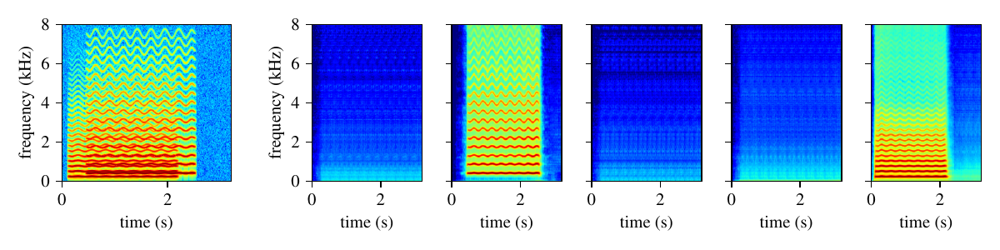
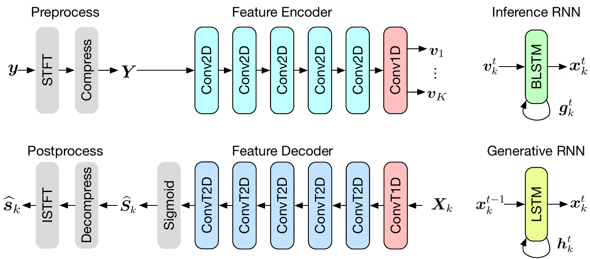

# DVAE-BSS

Dynamical variational auto-encoding for unsupervised blind sound separation.

A dynamical (recurrent) variational auto-encoder that learns to split audio mixtures into
their sources **from mixtures alone**: no isolated source signals, labels or target counts are
needed during training. The model is trained by reconstructing mixtures as a sum of `K`
decoded sources, each with its own latent trajectory under a learned dynamical prior. Because
the prior is recurrent, the model separates signals of any duration.



*A two-note mixture (left) and the `K = 5` outputs of a model trained on RWC (right). Each
note ends up in its own output; the remaining outputs stay nearly empty.*

This is the code for Chapter 6 of my Ph.D. dissertation. It follows
[VAE-BSS](https://github.com/jundsp/VAE-BSS), the non-dynamical model from our EUSIPCO 2021
paper, which separates fixed-size spectrograms only. The tag `dissertation-2024` holds the
original research scripts exactly as used for the dissertation; the current branch is a
cleaned-up package that reproduces them (see [Differences](#differences-from-the-dissertation-code)).

## Install

```bash
git clone https://github.com/jundsp/DVAE-BSS.git
cd DVAE-BSS
python -m venv .venv && source .venv/bin/activate
pip install -e .                    # core: train, separate, evaluate
pip install -e ".[experiments]"     # plus the baseline and figure scripts
```

Python 3.10 or later. For the exact versions it was tested with (Python 3.12, PyTorch 2.14),
use `pip install -r requirements.txt && pip install -e . --no-deps`. Training works on CPU but
is meant for a GPU.

## Usage

### Train

Training needs only a folder of isolated sounds, for example single instrument notes at
16 kHz. Mixtures are generated on the fly: random sounds are strung into sparse streams of a few
seconds, and `--num-targets` streams are added to form each mixture. The model never sees the
streams themselves.

```bash
dvae-train --train-data data/notes --out runs/k5
```

The defaults are the best configuration from the dissertation (`K = 5` sources, compression
`c = 0.5`, likelihood variance `σ² = 0.1`, strided encoder, LSTM with 512 units). The
dissertation models used a batch of 100 streams of about 8 s and trained for about 500 epochs.
`dvae-train --help` lists every option.

A run folder holds `config.json`, `log.csv`, `model.pt` (the model to use) and `resume.pt`
(continue with `--resume runs/k5/resume.pt`). For several GPUs, launch the same command
through `torchrun`; [`scripts/slurm_train.sh`](scripts/slurm_train.sh) does this on a Slurm
cluster.

### Separate

```bash
dvae-separate mixture.wav -m runs/k5/model.pt -o separated/ --plot
```

This writes `separated/mixture_source1.wav` … `mixture_sourceK.wav`, and with `--plot` a
spectrogram figure. Any number of files can be passed at once. Sources come out in no
particular order, and with more outputs than sources the extra outputs are close to silent.

From Python:

```python
from dvae_bss import Separator, load_model
from dvae_bss.data import read_audio

model, stft = load_model("runs/k5/model.pt")
separator = Separator(model.eval(), stft)
mixture = read_audio("mixture.wav")   # mono, resampled to 16 kHz, shape (samples,)
sources = separator(mixture[None])    # shape (1, K, samples)
```

### Evaluate

```bash
dvae-evaluate -m runs/k5/model.pt -d data/test_set -o results/dvae
```

A test set is a folder with `mix.json` and `audio/` (see `PremixedDataset` in
[`data.py`](src/dvae_bss/data.py));
[`experiments/data_prep/make_test_set.py`](experiments/data_prep/make_test_set.py) builds one
from a folder of isolated sounds. Each true source is matched to the closest estimate (minimum
L1 distance between waveforms), and the matches are scored with SI-SDR, SIR and SAR. The command writes one
record per source to `results.json` and the averages to `summary.json`.

### Checkpoints from the dissertation code

`dvae-separate`, `dvae-evaluate` and `load_model` also read checkpoints written by the
original scripts (a bare state dict plus a `configuration.txt`). The configuration is picked
up from the checkpoint's folder, or given with `--legacy-config`.

## Model



The mixture `y` is turned into a compressed magnitude spectrogram `Y` (STFT with a 512-point
Hann window and hop 128, magnitudes raised to the power `c`). A convolutional feature encoder
downsamples it in time and frequency, and a 1-D convolution splits the features into `K`
per-source sequences `v_k`. A bidirectional LSTM infers each source's latent trajectory
`x_k`. Under the generative model, an LSTM prior predicts each latent state from the previous
one, and the feature decoder maps a trajectory back to a source spectrogram `Ŝ_k`.

Training maximises the evidence lower bound: the decoded sources must add up to the mixture
under a scale-invariant Normal (or Laplace) likelihood, and the inferred trajectories must stay
close to the dynamical prior. At separation time the posterior means are decoded, used as ratio
masks on the mixture spectrogram, and inverted with the mixture phase.

The model and its options are documented in [`model.py`](src/dvae_bss/model.py), including the
tensor shapes and how the code names map to the dissertation's symbols. A dilated encoder
(`--encoder dilated`), GRUs (`--rnn-type gru`) and a Laplace likelihood (`--laplace`) are also
available.

## Results

From the dissertation, for a model trained on the RWC Musical Instrument Sound Database
(`K = 5`, `c = 0.5`, `σ² = 0.1`) and tested on mixtures of two notes. Values are averages in dB.
IBM and IRM are the ideal binary and ratio masks, oracle baselines computed from the true
sources; Mix is the unprocessed mixture.

| Test set | Metric | Mix | DVAE | IBM | IRM |
|---|---|---:|---:|---:|---:|
| RWC | SI-SDR | −0.01 | **13.26** | 15.93 | 16.33 |
| | SIR | −0.01 | 36.07 | 40.11 | 33.83 |
| | SAR | 77.99 | 14.61 | 16.20 | 16.57 |
| NSynth (not seen in training) | SI-SDR | 0.01 | **9.58** | 17.00 | 17.15 |
| | SIR | 0.01 | 35.16 | 41.69 | 35.95 |
| | SAR | 79.09 | 11.64 | 17.11 | 17.28 |

Datasets are not included: RWC is not freely redistributable, and NSynth is available from
Magenta. [`experiments/`](experiments/README.md) has the scripts for the baselines and for every
results figure of the chapter (compression, number of sources, variance, per-instrument and
pitch/time breakdowns, feature maps), and a table of which script produces which figure.

## Repository layout

| Path | Contents |
|---|---|
| [`src/dvae_bss/`](src/dvae_bss) | the package: `model`, `layers`, `losses`, `audio` (STFT front end), `separator`, `data`, `metrics`, `checkpoint`, `evaluation`, `plotting` |
| [`src/dvae_bss/cli/`](src/dvae_bss/cli) | `dvae-train`, `dvae-separate`, `dvae-evaluate` |
| [`experiments/`](experiments) | baselines (ideal masks, ICA/NMF, MixIT), figure scripts, data preparation |
| [`scripts/slurm_train.sh`](scripts/slurm_train.sh) | multi-GPU training on a Slurm cluster |
| [`tests/`](tests) | unit tests, CLI tests on synthetic audio, and equivalence tests against the original code |

## Differences from the dissertation code

The package was refactored from the research scripts at `dissertation-2024`. The model is the
same, and parameter names are unchanged so old checkpoints load. `tests/test_equivalence.py`
checks the new code against outputs recorded from the original: forward passes, loss terms, a
20-step training run, separation output, the STFT and the metrics.

Deliberate changes:

- **Bug fixes.** A dilated separator with more than one layer crashed (its last layer was added
  twice). The decoders required the last two layer widths to be equal. SI-SDR divided by zero on
  silent targets. `--lr` was ignored. The ideal-mask baseline rescaled the sources by the
  mixture gain and stored the Mix, IRM and IBM results in one shared dictionary, so its numbers
  can differ slightly from the dissertation's IBM/IRM columns.
- **Evaluation** runs on the whole test set; the original scripts stopped after a fixed number
  of batches. Use `--max-batches` for a quick check.
- **Training** runs on a single CPU or GPU without Slurm, uses `torchrun` for several GPUs, and
  writes a CSV log instead of TensorBoard. Random initialisation and data order are not
  bit-identical to the original.
- **Dependencies.** No torchaudio, librosa or private plotting packages; audio I/O uses
  `soundfile` and resampling uses SciPy.
- **Scope.** Experimental model variants that were not used in the chapter (pooled, complex and
  non-dynamical models) and the loaders for MNIST, MUMS, VCTK and MUSDB are not carried over.
  They remain at the `dissertation-2024` tag.

## Tests

```bash
pip install -e ".[dev]"
pytest
```

The full suite runs on CPU in under a minute.

## References

- J. Neri, *Bayesian Hierarchical Modeling and Inference of Mixed Audio Sources*, Ph.D.
  dissertation, McGill University, 2024.
- J. Neri, R. Badeau, and P. Depalle, "Unsupervised Blind Source Separation with Variational
  Auto-Encoders," in *Proc. 29th European Signal Processing Conference (EUSIPCO)*, Dublin,
  Ireland, 2021. [Paper](https://hal.science/hal-03255341) ·
  [Code](https://github.com/jundsp/VAE-BSS)
- J. Neri, P. Depalle, and R. Badeau, "Dynamical Variational Auto-Encoding Unsupervised Blind
  Sound Separation," in preparation.

## License

GPL-3.0. See [LICENSE](LICENSE).
