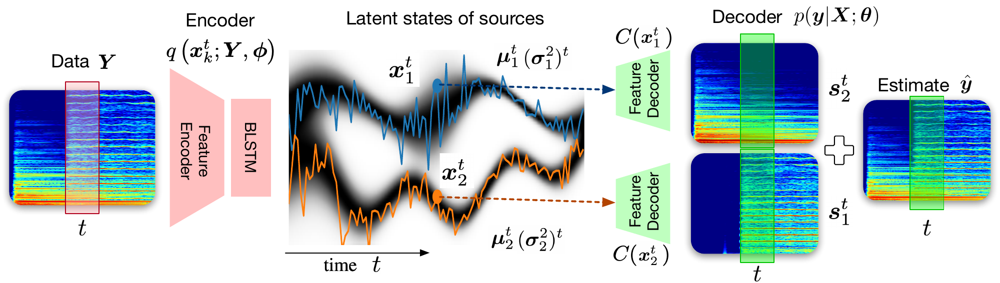

# DVAE-BSS

Dynamical variational auto-encoding for unsupervised blind sound separation.
**[Listen to examples](https://jundsp.github.io/DVAE-BSS/)**

Code for Chapter 6 of my Ph.D. dissertation, *Bayesian Hierarchical Modeling and Inference of
Mixed Audio Sources* (McGill University, 2024). It extends
[VAE-BSS](https://github.com/jundsp/VAE-BSS) (EUSIPCO 2021) with a dynamical prior, so it
separates signals of any length.

The model learns to separate sources from mixtures alone. It explains each mixture as a sum
of `K` decoded sources, each with its own latent trajectory under a learned recurrent prior.
No isolated sources or labels are used in training.




*A two-note mixture and the five outputs of the pretrained model. Each note lands in its own
output and the other three stay nearly silent.*

## Usage

```bash
pip install -e .                          # or ".[experiments]" for the baseline/figure scripts

dvae-separate examples/mixture.wav --plot # pretrained model, writes to separated/
dvae-train --train-data data/notes --out runs/k5
dvae-evaluate -m runs/k5/model.pt -d data/test_set -o results/dvae
```

Training only needs a folder of isolated sounds (e.g. single instrument notes at 16 kHz).
Mixtures are made on the fly from them. The defaults are the best settings from the
dissertation. `pretrained/dvae_rwc_k5.pt` is the dissertation's model, trained on RWC notes,
so expect it to work best on similar material. The model itself is in
[`model.py`](src/dvae_bss/model.py), and [`experiments/`](experiments/README.md) has the
baselines and the scripts for the chapter's figures.

The tag `dissertation-2024` has the original research scripts. `main` is a cleanup that
reproduces them (`tests/test_equivalence.py` checks this) and still loads the old checkpoints.

## Results

From the dissertation, for `K = 5` trained on RWC and tested on two-note mixtures, in dB. IBM
and IRM are oracle masks.

| Test set | Metric | Mix | DVAE | IBM | IRM |
|---|---|---:|---:|---:|---:|
| RWC | SI-SDR | −0.01 | **13.26** | 15.93 | 16.33 |
| | SIR | −0.01 | 36.07 | 40.11 | 33.83 |
| | SAR | 77.99 | 14.61 | 16.20 | 16.57 |
| NSynth (unseen) | SI-SDR | 0.01 | **9.58** | 17.00 | 17.15 |
| | SIR | 0.01 | 35.16 | 41.69 | 35.95 |
| | SAR | 79.09 | 11.64 | 17.11 | 17.28 |

Datasets are not included: [RWC Instruments](https://doi.org/10.5281/zenodo.17170844),
[NSynth](https://magenta.tensorflow.org/datasets/nsynth).

## Citation

```bibtex
@phdthesis{neri2024bayesian,
  author = {Neri, Julian},
  title  = {Bayesian Hierarchical Modeling and Inference of Mixed Audio Sources},
  school = {McGill University},
  address = {Montr{\'e}al, Canada},
  year   = {2024},
  type   = {Ph.D. dissertation},
  note   = {Chapter 6: Variational auto-encoding unsupervised blind source separation},
  url    = {https://escholarship.mcgill.ca/downloads/2v23w0350}
}
```

A journal version (Neri, Depalle, Badeau) is in preparation.

## License

Code GPL-3.0. Pretrained weights CC BY-NC 4.0, following the RWC licence.
