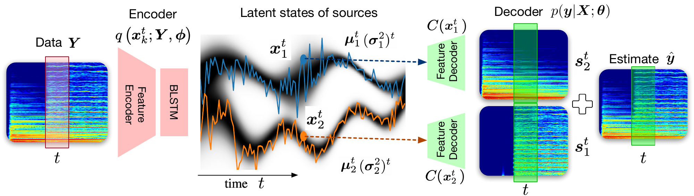
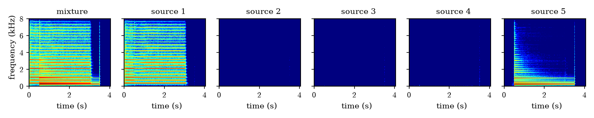

# DVAE-BSS

Dynamical variational auto-encoding for unsupervised blind sound separation.
**[Listen to examples](https://jundsp.github.io/DVAE-BSS/)**

Code for [Chapter 6 of my Ph.D. dissertation][dissertation] (PDF), *Bayesian Hierarchical Modeling and Inference of
Mixed Audio Sources* (McGill University, 2024). It extends
[VAE-BSS](https://github.com/jundsp/VAE-BSS) (EUSIPCO 2021) with a dynamical prior, so it
separates signals of any length.

The model learns to separate sources from mixtures alone. It explains each mixture as a sum
of `K` decoded sources, each with its own latent trajectory under a learned recurrent prior.
No isolated sources or labels are used in training.





*A mixture of two real recordings, a reed note and a guitar note from the NSynth test set
(`examples/mixture.wav`), and the five outputs of the pretrained model, made with
`dvae-separate examples/mixture.wav --plot`. Each note lands in its own output and the other
three stay silent. The mixture is out of sample: the model was trained and validated on RWC
only and never heard NSynth.*

## Usage

```bash
pip install -e .                          # or ".[experiments]" for the baseline/figure scripts

dvae-separate examples/mixture.wav --plot # pretrained model, writes to separated/
dvae-train --train-data data/notes --out runs/k5
dvae-evaluate -m runs/k5/model.pt -d data/test_set -o results/dvae
```

Training only needs a folder of isolated sounds (e.g. single instrument notes at 16 kHz).
Mixtures are made on the fly from them. The defaults are the best settings from the
[dissertation][dissertation]. `pretrained/dvae_rwc_k5.pt` is a `K = 5` model from the dissertation's
experiments, trained on RWC notes, so expect it to work best on similar material (see
[`pretrained/README.md`](pretrained/README.md) for how it was chosen and its scores). The model itself is in
[`model.py`](src/dvae_bss/model.py), and [`experiments/`](experiments/README.md) has the
baselines and the scripts for the chapter's figures.

The tag `dissertation-2024` has the original research scripts. `main` is a cleanup that
reproduces them (`tests/test_equivalence.py` checks this) and still loads the old checkpoints.

## Results

From the [dissertation][dissertation] (Chapter 6), for `K = 5` trained on RWC and tested on two-note mixtures, in dB. IBM
and IRM are oracle masks.

| Test set | Metric | Mix | DVAE | IBM | IRM |
|---|---|---:|---:|---:|---:|
| RWC | SI-SDR | −0.01 | **13.26** | 15.93 | 16.33 |
| | SIR | −0.01 | 36.07 | 40.11 | 33.83 |
| | SAR | 77.99 | 14.61 | 16.20 | 16.57 |
| NSynth (unseen) | SI-SDR | 0.01 | **9.58** | 17.00 | 17.15 |
| | SIR | 0.01 | 35.16 | 41.69 | 35.95 |
| | SAR | 79.09 | 11.64 | 17.11 | 17.28 |

Datasets are not included: [RWC Instruments](https://doi.org/10.5281/zenodo.17170844),
[NSynth](https://magenta.tensorflow.org/datasets/nsynth).

The example mixture and the [demo page](https://jundsp.github.io/DVAE-BSS/) use notes from the
NSynth test set (Engel et al., 2017, Google Magenta), licensed
[CC BY 4.0](https://creativecommons.org/licenses/by/4.0/). They are out of sample: the
pretrained model was trained and validated on RWC only. The notes are `reed_acoustic_011-065-075`,
`guitar_acoustic_014-058-050`, `brass_acoustic_046-059-075`, `brass_acoustic_046-067-075`,
`guitar_acoustic_021-067-127`, `string_acoustic_056-064-100`, `keyboard_acoustic_004-059-127`,
`flute_acoustic_002-072-127` and `mallet_acoustic_062-063-100`, mixed by
`experiments/data_prep/make_nsynth_examples.py`.

## Generated data

Two generators write audio to `data/` (not tracked by git), so nothing needs downloading:

```bash
dvae-make-twonote --out data/TwoNote        # the dissertation's TwoNote test set, 1326 mixtures
dvae-make-synthetic --out data/synthetic    # new: notes for training and a two-note test set
dvae-train --train-data data/synthetic/train --val-data data/synthetic/val --out runs/syn
```

`dvae-make-twonote` rebuilds the TwoNote set described in the [dissertation's][dissertation] appendix.
`dvae-make-synthetic` is not from the dissertation. It makes 3000 training, 300 validation and
300 test notes from six instrument families (plucked and bowed strings, reed, brass, bell,
organ), with pitch, timbre, vibrato and decay drawn at random, plus 500 two-note test
mixtures. The same seed gives the same files.

## Citation

The dissertation is open access: [PDF][dissertation].

```bibtex
@phdthesis{neri2024bayesian,
  author = {Neri, Julian},
  title  = {Bayesian Hierarchical Modeling and Inference of Mixed Audio Sources},
  school = {McGill University},
  address = {Montr{\'e}al, Canada},
  year   = {2024},
  type   = {Ph.D. dissertation},
  note   = {Chapter 6: Variational auto-encoding unsupervised blind source separation},
  url    = {https://hdl.handle.net/20.500.14905/94099}
}
```

A journal version (Neri, Depalle, Badeau) is in preparation.

## License

Code GPL-3.0. Pretrained weights CC BY-NC 4.0, following the RWC licence.

[dissertation]: https://mcgill.scholaris.ca/server/api/core/bitstreams/2334758f-542d-45cc-897d-37b6dd949f12/content
